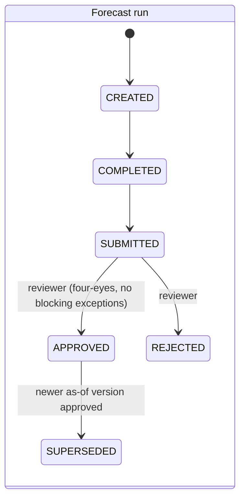
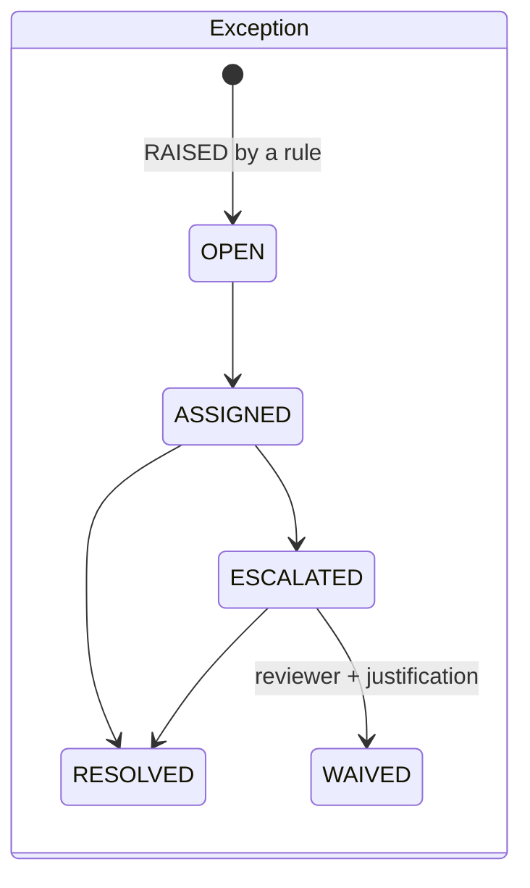

# Actors and workflow

## Who the actors are

| Brief | In CashPilot | User IDs |
|---|---|---|
| Customer / account holder | The finance owner of a group entity (the bank-account holder); submits manual forecast items and sees only their own entity. External customers appear as *counterparties*, not users. | one `ACCOUNT_HOLDER` per entity |
| Operations analyst | Treasury operations: runs reconciliation and forecasts, works exceptions, prepares re-runs | `OPS_ANALYST` |
| Risk / compliance reviewer | Approves or rejects forecast versions, waives exceptions with a justification, freezes accounts, approves large payments | `RISK_REVIEWER` |
| System administrator | Opens/closes accounts, loads FX rates, publishes scenario versions, manages users | `SYS_ADMIN` |
| (system) | Scheduler for automated steps (feeds, completion of runs, raising exceptions) | `SYSTEM` (`USR-0001`) |

Users are synthetic role labels (`display_name` like "Operations Analyst 01"); there is no
personal data. Authentication is out of scope: every action names its actor with `--as-user`.

## Permission matrix

| Action | SYSTEM | SYS_ADMIN | OPS_ANALYST | RISK_REVIEWER | ACCOUNT_HOLDER |
|---|---|---|---|---|---|
| View an entity's cash | | ✓ | ✓ | ✓ | own entity only |
| Create / complete a forecast run | ✓ | | ✓ | | |
| Submit a run | | | ✓ | | |
| Approve / reject a run | | | | ✓ (≠ preparer, ≠ submitter) | |
| Supersede a run | ✓ | | | ✓ | |
| Assign an exception | ✓ | | ✓ | | |
| Escalate an exception | | | ✓ | | |
| Resolve an exception | | | ✓ | ✓ | |
| Waive an exception (with justification) | | | | ✓ | |

Every attempt is written to `audit_event` with `ALLOWED` or `DENIED` and the reason.

## Lifecycles (append-only)

State changes are rows in event tables; `status_at_end` is derived from the last event.
SQLite triggers in `sql/append_only_sqlite.sql` block UPDATE/DELETE on history.





Bank accounts (ACTIVE ⇄ FROZEN → CLOSED), receivables (OPEN → PARTIALLY_PAID / OVERDUE →
PAID / WRITTEN_OFF), payables (SCHEDULED → APPROVED ⇄ ON_HOLD → PAID / CANCELLED) and forecast
items (ACTIVE → SETTLED / CANCELLED via `cf_revision`) are listed in
[DATA_DICTIONARY.md](DATA_DICTIONARY.md#effective-dates-and-lifecycles).

## The exception path, end to end (look-ahead leakage)

1. `R-LEAK-001` finds a legacy run whose lineage contains records recorded after its cutoff
   → exception (CRITICAL, decision `SUPERSEDE_WITH_RERUN`).
2. The system assigns it to an analyst, who escalates it.
3. The analyst creates an as-of re-run of the same cutoff (next version, process `CASHPILOT`,
   purpose `REMEDIATION`, `supersedes_run_id` = the leaky run) and submits it.
4. A different risk reviewer approves it; the leaky run receives a `SUPERSEDED` event that
   names its replacement and the exception; the reviewer resolves the exception.
5. Nothing is edited: the leaky version, its events and its lineage stay in the history.

## Try it

```bash
cashpilot all --profile starter --out out/demo          # work on a copy
cashpilot exceptions --data out/demo --type LOOKAHEAD_LEAKAGE
cashpilot forecast --data out/demo --cutoff 2026-10-01 --as-user USR-0003 --purpose LIVE
cashpilot run-event --data out/demo --run FCAST-2026-10-01-002 --event SUBMITTED --as-user USR-0003
cashpilot run-event --data out/demo --run FCAST-2026-10-01-002 --event APPROVED --as-user USR-0003   # refused: four-eyes
cashpilot run-event --data out/demo --run FCAST-2026-10-01-002 --event APPROVED --as-user USR-0005   # reviewer: approved
cashpilot view-entity --data out/demo --entity ENT-000002 --as-user USR-0007   # denied: not their entity
```
