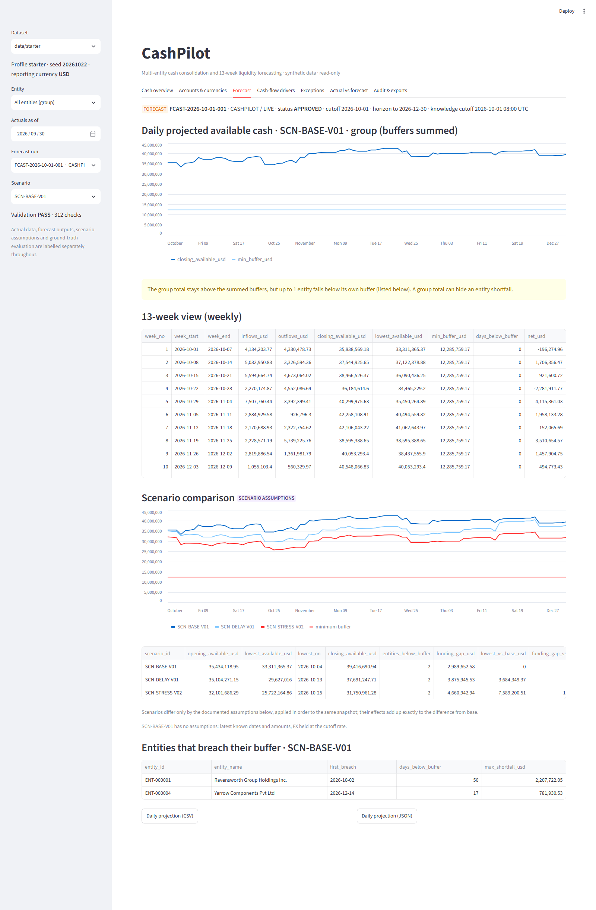

# Web dashboard

A browser interface over the existing CashPilot engine. It is **read-only**: it never writes to the
dataset, and it contains no financial logic of its own. Every figure comes from the same code the
command-line tool uses (positions, forecast runs, scenario rebuild, variance attribution, detectors,
evaluation), selected and joined in [`dashboard/data.py`](../src/cashpilot/dashboard/data.py) and laid out in
[`dashboard/app.py`](../src/cashpilot/dashboard/app.py).

## Run it

```bash
pip install -r requirements-dashboard.txt      # the core pins first, then Streamlit 1.66.1
pip install -e . --no-deps
cashpilot dashboard                            # http://localhost:8501, dataset data/starter
cashpilot dashboard --data out/check --port 8600
cashpilot dashboard --data data/full           # after `cashpilot all --profile full` (the bulk files are not in git)
```

* `requirements-dashboard.txt` starts with `-r requirements-dev.txt`, so numpy, pandas and PyYAML stay exactly
  pinned (the dataset checksums depend on them). pip fails loudly rather than upgrading them. This was checked
  in an isolated environment before Streamlit was added (`pip check` clean, versions unchanged).
* The dashboard is an optional extra: without Streamlit everything else works, and `cashpilot dashboard`
  explains how to install it.
* Each tab has a link: `http://localhost:8501/?tab=Forecast`.
* Loading takes about 2 s for the starter dataset and 11 s for the full one; results are cached per dataset
  and recomputed when the dataset files change (a signature of their modification times and sizes is part
  of every cache key, so a cached result is never served after the data changed).

## Screens

The sidebar selects the dataset, entity (or the group), the "actuals as of" date, the forecast run and the
scenario. Throughout, four kinds of content are labelled separately: **ACTUAL** data, **FORECAST** outputs,
**SCENARIO ASSUMPTIONS**, and **GROUND TRUTH** (only in a collapsed reviewer section).

| Tab | Shows | Comes from |
|---|---|---|
| **Cash overview** ([screenshot](screenshots/01-cash-overview.png)) | total, available and restricted cash in USD, headroom over buffers, entities below buffer, actual cash over time; a warning on days that could not be fully converted | `entity_cash_position` |
| **Accounts & currencies** ([screenshot](screenshots/02-accounts-currencies.png)) | every bank account with its local balance, the FX rate used (and its date) and the USD value; currency exposure with an adjustable FX sensitivity; cash by entity and currency; FX rate history and the missing fixings with the decision the rules apply | `daily_cash_position`, `currency_rate`, `missing_fx_rates` |
| **Forecast** ([screenshot](screenshots/03-forecast.png)) | daily projected available cash against the minimum buffer, the 13-week weekly view, base / delayed-receipt / stress curves and comparison table, the documented assumptions and each one's effect, entities that breach their buffer and why | `forecast_position`, `scenario_assumption_effect`, `evaluate.liquidity_outlook` |
| **Cash-flow drivers** ([screenshot](screenshots/04-cash-flow-drivers.png)) | weekly cash by category, the individual receipts and payments (filterable, with dates shifted by the scenario), and **why the forecast changed** between two runs: items added, removed or changed with their reason, FX rate changes, opening-balance change | `engine.compare.scenario_items` (the scenario rebuilt from the run's lineage), `forecast_run_item`, `cf_revision` |
| **Exceptions** ([screenshot](screenshots/05-exceptions.png)) | all exceptions with filters; pick one to see why it was flagged, the rule, the decision, the identifiers, its append-only workflow history and the evidence (bank statement vs ledger, the gap in FX fixings, the duplicate beside its original, the unconverted item beside its invoice, the inputs a run saw from the future, the days below buffer); reconciliation status | `exception`, `exception_event`, the records they point at |
| **Actual vs forecast** ([screenshot](screenshots/06-actual-vs-forecast.png)) | weekly forecast vs actual with variance drivers, drill-down to the forecast items and ledger postings behind each driver, WAPE and bias by horizon, group cash-balance error, driver shares, and (collapsed) detection quality against the ground truth | `forecast_vs_actual`, `variance_attribution`, `evaluate.*`, `engine.explain` |
| **Audit & exports** ([screenshot](screenshots/07-audit-exports.png)) | run lifecycle events, access audit, input hashes, how each item was treated, a **Verify reproducibility** button, validation summary, dataset manifest, the command that regenerates the dataset, CSV/JSON downloads of every table shown | `forecast_run_event`, `audit_event`, `recreate_run`, `validation_summary.json`, `manifest.json` |

## What makes the numbers trustworthy

These are asserted by tests ([`test_dashboard_data.py`](../tests/test_dashboard_data.py)), not just claimed:

* The cash-flow items shown for any scenario reproduce the engine's projected inflows and outflows per entity and
  day **to the cent**, for every scenario of the run.
* Currency exposure sums to the consolidated total; each currency's local total is the sum of that currency's
  accounts only (local amounts are never added across currencies); the FX sensitivity is plain arithmetic and
  labelled as such.
* Entity totals flagged **INCOMPLETE** (a balance could not be converted because its rate is missing) are
  marked in the cash overview and the history chart, never presented as complete.
* A run that used inputs recorded after its cutoff **fails** the reproducibility check; clean runs pass.
* Weekly views add up to the daily series; scenario assumption effects add up to the difference from base.
* The dashboard does not modify a single file of the dataset (checked by comparing modification times around
  an interactive session).
* An app test drives every tab, scenario, run and entity filter, an exception trace, the reproducibility button,
  the "no dataset" and "dataset not processed" messages.

## Limits

* Read-only on purpose. Creating runs, approving them and waiving exceptions stay in the CLI, where the
  permission checks, four-eyes rule and audit trail already exist; a button that pretended to do these would
  have been a fake. See [ACTORS_WORKFLOW.md](ACTORS_WORKFLOW.md).
* One reporting currency per dataset. Column names in the engine embed `usd` and the dashboard assumes the
  reporting currency has two decimals (true for USD); making it configurable is a schema change that was not
  attempted.
* A group total can hide an entity shortfall: entity buffers are summed at group level, and the forecast tab says
  so when entities breach while the group does not.
* Item-level variance drill-down is stored for the base scenario only; weekly driver totals exist for all
  scenarios.
* No authentication: this is a local review tool for synthetic data. Do not expose it to a network.
* Streamlit is the only added dependency. Charts use its built-in Altair rendering; axis labels are Streamlit's
  defaults.

## Regenerating the screenshots

The pictures in [screenshots/](screenshots) were taken from the running dashboard with
[`scripts/take_screenshots.py`](../scripts/take_screenshots.py) (headless Edge or Chrome through the DevTools
protocol; a plain `--screenshot` only captures Streamlit's loading placeholder):

```bash
cashpilot dashboard --headless --port 8501        # one terminal
python scripts/take_screenshots.py http://localhost:8501 docs/screenshots
```


