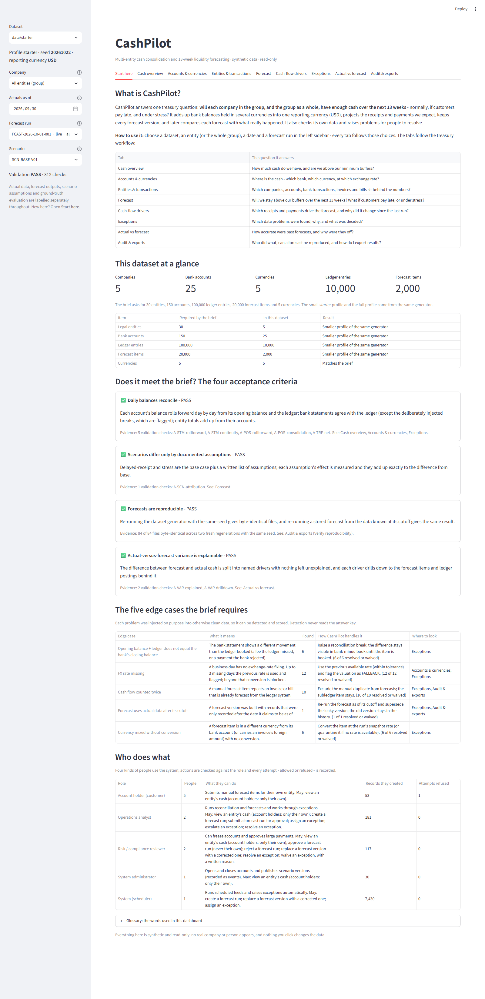
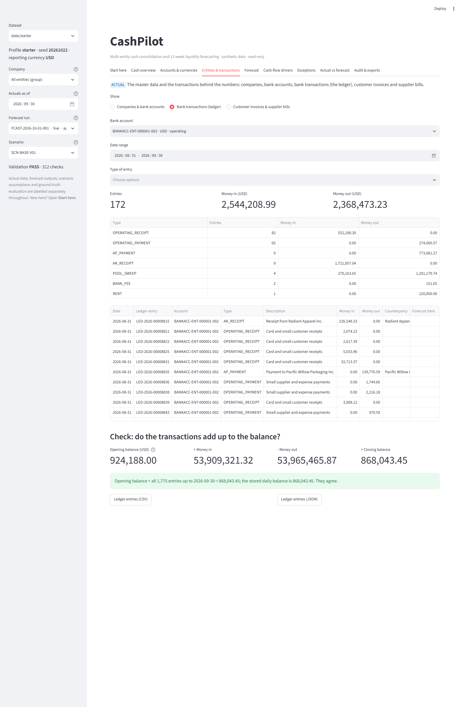
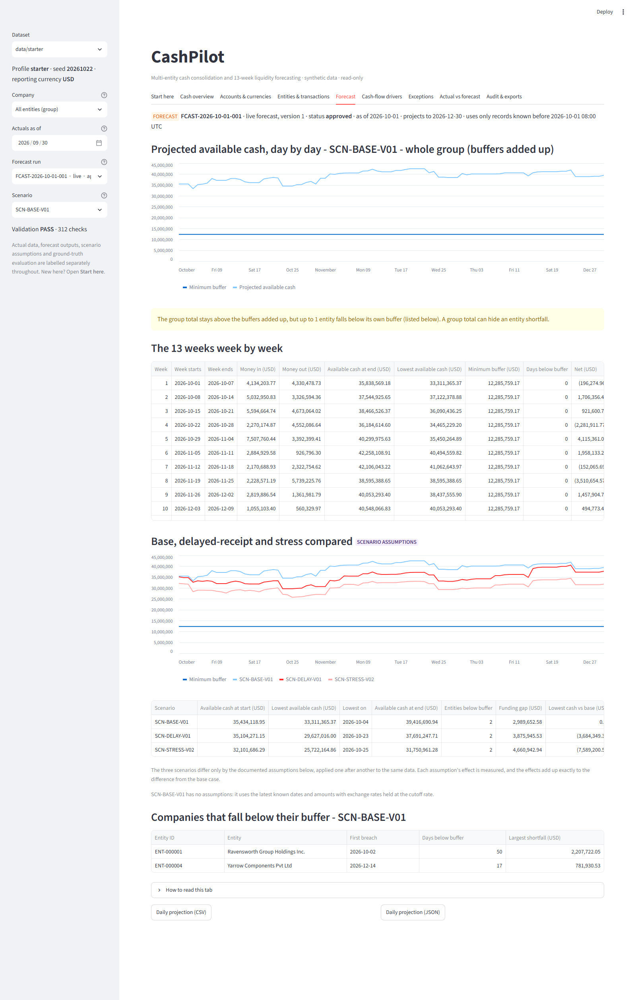

# Web dashboard

A browser interface over the existing CashPilot engine, written for people who are not programmers. It is
**read-only**: it never writes to the dataset, and it contains no financial logic of its own. Every figure comes
from the same code the command-line tool uses (positions, forecast runs, scenario rebuild, variance attribution,
detectors, evaluation), selected and joined in [`dashboard/data.py`](../src/cashpilot/dashboard/data.py),
[`explorer.py`](../src/cashpilot/dashboard/explorer.py) and [`guide.py`](../src/cashpilot/dashboard/guide.py), worded
in [`text.py`](../src/cashpilot/dashboard/text.py) and laid out in [`app.py`](../src/cashpilot/dashboard/app.py).

## Run it

```bash
pip install -r requirements-dashboard.txt      # the core pins first, then Streamlit 1.66.1
pip install -e . --no-deps
cashpilot dashboard                            # http://localhost:8501, dataset data/starter
cashpilot dashboard --data out/check --port 8600
cashpilot dashboard --data data/full           # after `cashpilot all --profile full` (the bulk files are not in git)
```

* `requirements-dashboard.txt` starts with `-r requirements-dev.txt`, so numpy, pandas and PyYAML stay exactly
  pinned (the dataset checksums depend on them). pip fails loudly rather than upgrading them. This was checked in an
  isolated environment before Streamlit was added (`pip check` clean, versions unchanged).
* The dashboard is an optional extra: without Streamlit everything else works, and `cashpilot dashboard` explains how
  to install it.
* Every tab has a link, for example `http://localhost:8501/?tab=Forecast`; the explorer sections too:
  `?tab=Entities %26 transactions&section=Bank transactions (ledger)`.
* Loading takes about 2 s for the starter dataset and 11 s for the full one. Results are cached per dataset and
  recomputed when the dataset files change (a signature of their modification times and sizes is part of every cache
  key, so a cached result is never served after the data changed).

## Where to start

Open the first tab, **Start here**. It explains in plain words what CashPilot is, which question each tab answers, how
big this dataset is compared with the brief (30 entities, 150 accounts, 100,000 ledger entries, 20,000 forecast items,
5 currencies), whether the four acceptance criteria hold (with the evidence), the five required edge cases and how many
were found, who the four kinds of users are, and a glossary.

The sidebar selects the dataset, **company** (or the whole group), the "actuals as of" date, the forecast run and the
scenario; every tab follows those choices. Throughout, four kinds of content are labelled separately: **ACTUAL** data,
**FORECAST** outputs, **SCENARIO ASSUMPTIONS**, and **GROUND TRUTH** (only in a collapsed reviewer section).

## The nine tabs

| Tab | The question it answers | Comes from |
|---|---|---|
| **Start here** ([screenshot](screenshots/00-start-here.png)) | What is this, does it meet the brief, who uses it? | `validation_summary.json`, `reproducibility.json`, `exception`, `audit_event` |
| **Cash overview** ([screenshot](screenshots/01-cash-overview.png)) | How much cash do we have and are we above our buffers? Total, available and restricted cash in USD, headroom, entities below buffer, cash over time; a warning on days that could not be fully converted | `entity_cash_position` |
| **Accounts & currencies** ([screenshot](screenshots/02-accounts-currencies.png)) | Where is the cash, in which currency, at which rate? Every account's local balance, the rate and its date, the USD value; currency exposure with an adjustable FX sensitivity; rate history and the missing fixings with the decision applied | `daily_cash_position`, `currency_rate` |
| **Entities & transactions** ([companies and accounts](screenshots/03-entities-accounts.png), [ledger](screenshots/03b-ledger-transactions.png), [invoices and bills](screenshots/03c-invoices-bills.png)) | What sits behind the numbers? Companies and bank accounts with their lifecycle; every bank transaction with a check that opening balance + money in - money out = the stored balance; customer invoices, supplier bills, how late customers pay by risk tier, the large one-off payments | `legal_entity`, `bank_account(_event)`, `ledger_entry`, `receivable(_event)`, `payable(_event)` |
| **Forecast** ([screenshot](screenshots/04-forecast.png)) | Will we stay above our buffers for 13 weeks, and if customers pay late or under stress? Daily and weekly projections, base / delayed-receipt / stress compared, the documented assumptions and each one's effect, who breaches and why | `forecast_position`, `scenario_assumption_effect`, `evaluate.liquidity_outlook` |
| **Cash-flow drivers** ([screenshot](screenshots/05-cash-flow-drivers.png)) | Which receipts and payments drive the forecast, and why did it change? Weekly cash by type, the individual items (with dates shifted by the scenario), and a run-to-run comparison with plain-language reasons, FX moves and the opening-cash change | `engine.compare.scenario_items`, `forecast_run_item`, `cf_revision` |
| **Exceptions** ([screenshot](screenshots/06-exceptions.png)) | Which data problems were found, why, and what was decided? Filters; pick one to see why it was flagged, the rule, the decision, its history and the evidence; reconciliation status | `exception`, `exception_event` and the records they point at |
| **Actual vs forecast** ([screenshot](screenshots/07-actual-vs-forecast.png)) | How accurate were past forecasts and why were they off? Week by week with named drivers, drill-down to the items and postings, errors as percentages, what explains the differences; (collapsed) detection quality against the ground truth | `forecast_vs_actual`, `variance_attribution`, `evaluate.*`, `engine.explain` |
| **Audit & exports** ([screenshot](screenshots/08-audit-exports.png)) | Who did what, can a forecast be reproduced, how do I export? Lifecycle, refused attempts, input fingerprints, how each item was handled, a **Verify reproducibility** button, validation, manifest, the regeneration command, downloads | `forecast_run_event`, `audit_event`, `recreate_run`, `manifest.json` |

## Where each core entity of the brief appears

| Entity | In the dashboard |
|---|---|
| LegalEntity | Entities & transactions (companies, ownership, currency, buffer, effective dates); Cash overview |
| BankAccount | Entities & transactions (accounts and their opened / frozen / closed history); Accounts & currencies |
| LedgerEntry | Entities & transactions (bank transactions and the opening + flows = closing check) |
| Receivable / Payable | Entities & transactions (invoices, bills, status, how late customers pay, large one-offs) |
| CashFlowForecast | Cash-flow drivers (every forecast item with source, date, scenario shift and how it was handled) |
| CurrencyRate | Accounts & currencies (rate history, rates used, missing fixings) |
| LiquidityScenario | Forecast (base / delayed receipt / stress, their assumptions and effects) |
| ForecastRun | Forecast, Cash-flow drivers (compare runs) and Audit & exports (versions, lifecycle, reproducibility) |

## Plain language

All wording lives in [`text.py`](../src/cashpilot/dashboard/text.py): friendly column names and help texts, the meaning of every
variance driver, forecast-item treatment, run-to-run reason, exception type, role and permission, and a glossary. Money is
shown with thousands separators and two decimals, errors as percentages, dates as `2026-10-01`, and empty cells as blanks.
Each tab has a "How to read this tab" box. A test checks that **every code the engine can produce has an explanation**,
so a new code cannot silently appear as jargon.

## What makes the numbers trustworthy

These are asserted by tests ([`test_dashboard_data.py`](../tests/test_dashboard_data.py),
[`test_dashboard_explorer.py`](../tests/test_dashboard_explorer.py), [`test_dashboard_app.py`](../tests/test_dashboard_app.py)), not just claimed:

* The cash-flow items shown for any scenario reproduce the engine's projected inflows and outflows per entity and day
  **to the cent**, for every scenario of the run.
* For every account, opening balance + all ledger inflows - outflows equals the stored daily balance.
* Currency exposure sums to the consolidated total; each currency's local total is the sum of that currency's accounts
  only (local amounts are never added across currencies); the FX sensitivity is plain arithmetic and labelled as such.
* Entity totals flagged **INCOMPLETE** (a balance could not be converted because its rate is missing) are marked in the
  cash overview and the history chart, never presented as complete.
* A run that used inputs recorded after its cutoff **fails** the reproducibility check; clean runs pass.
* The acceptance criteria shown on *Start here* are read from the validation and reproducibility files the pipeline saved;
  a dataset folder without them shows "Not recorded", never a pass.
* The dashboard does not modify a single file of the dataset (checked by comparing modification times around a session).
* An app test drives every tab, scenario, run and company filter, all three explorer sections, an exception trace, the
  reproducibility button, and the "no dataset" and "not processed" messages; another checks that no table shows the word
  `None` or a mixed-type column.

## Limits

* Read-only on purpose. Creating runs, approving them and waiving exceptions stay in the CLI, where the permission checks,
  four-eyes rule and audit trail already exist; a button that pretended to do these would have been a fake. See
  [ACTORS_WORKFLOW.md](ACTORS_WORKFLOW.md).
* One reporting currency per dataset (USD). Engine columns embed `usd`, and the dashboard assumes two decimals.
* A group total can hide an entity shortfall: entity buffers are added up at group level, and the forecast tab says so when
  entities breach while the group does not.
* Item-level variance drill-down is stored for the base scenario only; weekly driver totals exist for all scenarios.
* The ledger and invoice lists show the first 1,000-2,000 rows (download for all). On the full dataset the first load takes
  about 11 s.
* No authentication: this is a local review tool for synthetic data. Do not expose it to a network.
* Streamlit is the only added dependency; layout can differ slightly between Streamlit versions (1.66.1 is pinned).

## Regenerating the screenshots

The pictures in [screenshots/](screenshots) were taken from the running dashboard with
[`scripts/take_screenshots.py`](../scripts/take_screenshots.py) (headless Edge or Chrome through the DevTools protocol; a plain
`--screenshot` only captures Streamlit's loading placeholder):

```bash
cashpilot dashboard --headless --port 8501        # one terminal
python scripts/take_screenshots.py http://localhost:8501 docs/screenshots
```




