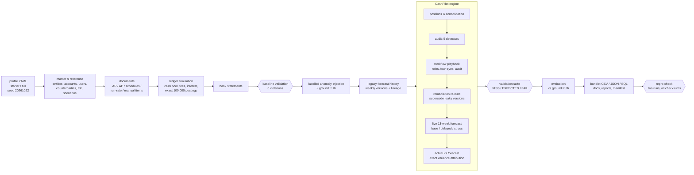

# Design

## The problem, as understood

A group of 30 companies holds cash in 150 bank accounts across five currencies. Treasury must
answer one question every week: *will each company, and the group, have enough cash over the
next 13 weeks - normally, if customers pay late, and in a stress?* To answer it credibly the
platform has to:

1. **consolidate** balances (account → entity → group, one reporting currency),
2. **project** known and estimated cash flows forward, under documented scenarios,
3. **keep every forecast version** and later compare it with what actually happened,
4. **expose decisions and exceptions** (bad data, broken reconciliations, stale FX, forecasts
   built with information they could not have had) and route them to the right people,
5. **prove** all of the above on data whose truth is known: hence the synthetic dataset with a
   separate ground truth.

## Architecture

| Package | Responsibility |
|---|---|
| `core/` | money in integer minor units, business calendar, deterministic IDs, named seeded RNG streams, profiles |
| `schema/` | the data dictionary (YAML) - drives docs, SQL DDL and structural validation |
| `generate/` | master data, documents with rule-based behaviour, ledger simulation, statements, anomaly injection, legacy history |
| `engine/` | FX staleness rule, positions, forecast runs (snapshot → rules → data-quality gate → scenarios → projection), workflow, comparison, orchestration |
| `quality/` | detection primitives, dataset-level detectors, validation suite |
| `evaluate/` | metrics against the ground truth, reproducibility check |
| `export/`, `report/` | CSV/JSON/SQL bundle and manifest; Markdown reports |
| `cli.py`, `pipeline.py` | commands for the pipeline and for the workflow actors |
| `dashboard/` | optional read-only web dashboard: `data.py`, `explorer.py`, `guide.py` (Streamlit-free views over existing engine results, tested), `text.py` (plain-language wording) and `app.py` (Streamlit layout); see [DASHBOARD.md](DASHBOARD.md) |

## Time model

* **Business dates vs knowledge time.** Every record has a business date (posting, due, expected
  date) and a `recorded_at` timestamp (when the system learned it). Bank statements arrive at
  06:00 the next business day, FX fixings at 16:00, invoices during office hours.
* **Forecast runs are as-of.** A run with cutoff *d* reads only what was recorded before 08:00 UTC
  on *d* (D-019). Changing or adding later data can never change an old run - tested.
* **Calendar.** Actuals 2026-01-01 → 2026-09-30; scheduled flows to 2026-12-31; weekly legacy
  runs from `FCAST-2026-01-01-001` (fortnightly in the starter profile); the live run is
  `FCAST-2026-10-01-001`, whose 91-day horizon ends on 2026-12-30.

## Key decisions (full list in [DECISION_LOG.md](DECISION_LOG.md))

| Decision | Trade-off accepted |
|---|---|
| Integer minor units everywhere (D-005) | slightly more code for formatting; in exchange every reconciliation is exact |
| As-of snapshots via `recorded_at` (D-006, D-019) | every input needs a knowledge timestamp; in exchange reproducibility and leakage detection come for free |
| Append-only history; status derived from events (D-007) | a status lookup is a query, not a column read; in exchange nothing is ever overwritten |
| One YAML dictionary for docs, DDL and validation (D-008) | a custom loader; in exchange docs and checks cannot drift |
| Rule-based forecast, no ML (D-009) | lower accuracy far out; in exchange exact, explainable variance |
| Outcomes from tiered behavioural rules (D-014) | parameters are judgement; in exchange labels are derived, not random |
| Cash pool simulation (D-015, D-021) | more simulation logic; in exchange realistic balances and genuine intercompany/FX flows |
| Legacy process without data-quality gate (D-022) | two process variants; in exchange anomalies really affect past forecasts and the gate's value is measurable |
| Anomalies injected into a validated baseline (D-023) with hard cases (D-024) | metrics are not all 100%; in exchange they mean something |
| Exact item-level variance attribution (D-027) | large drill-down table; in exchange zero unexplained residual |

## How we know it works

* **Tests** - 153 tests, including the four acceptance criteria and hand-calculated FX and forecast fixtures ([TESTING.md](TESTING.md)).
* **Validation** - clean baseline: 0 violations; final dataset: no unexpected violations, every
  anomaly check matches the ground truth exactly ([data/full/validation_summary.md](../data/full/validation_summary.md)).
* **Evaluation** - detection precision/recall per edge case, forecast and balance accuracy,
  variance drivers ([data/full/reports/evaluation.md](../data/full/reports/evaluation.md)).
* **Reproducibility** - two fresh regenerations compared file by file
  ([data/full/reproducibility.md](../data/full/reproducibility.md)); CI repeats it on Ubuntu and Windows.

## Scale and performance (full profile, one laptop)

~1.2 M rows across 34 tables. Generation ~30 s, CashPilot processing ~40 s, validation, evaluation
and export of CSV/JSON/SQL a few minutes more. Two hotspots were optimised during the build
(account lookups 73 s → 10 s; projection arrays and vectorised money formatting halved the engine
time) - see the commit history.
