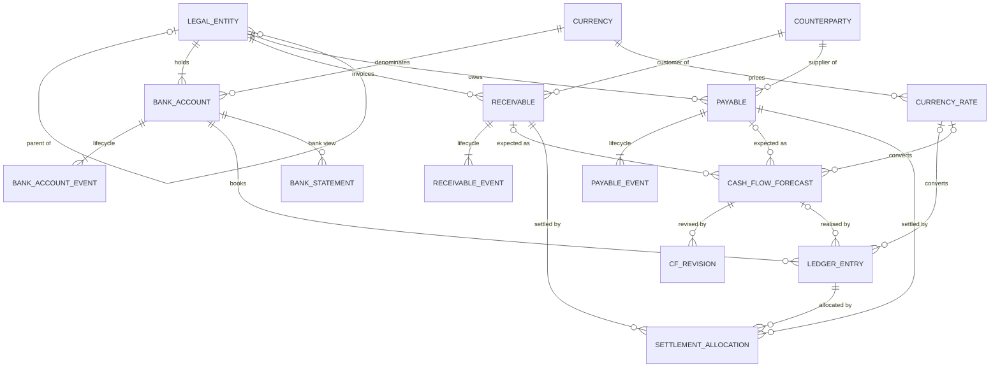

# Entity-relationship diagrams

Full field-level detail, cardinality and optionality for every foreign key are in
[DATA_DICTIONARY.md](DATA_DICTIONARY.md). Crow's-foot notation: `||` exactly one,
`o|` zero or one, `|{` one or more, `o{` zero or more.

## 1. Treasury data: entities, accounts, documents and cash

`SETTLEMENT_ALLOCATION` resolves the many-to-many between cash postings and documents: one
customer transfer can pay several invoices (bulk payment) and one invoice can be paid in parts.

## 2. Forecasting, scenarios and workflow

```mermaid
erDiagram
    LIQUIDITY_SCENARIO ||--o{ SCENARIO_ASSUMPTION_LINK : "made of"
    SCENARIO_ASSUMPTION ||--o{ SCENARIO_ASSUMPTION_LINK : "used in"
    LIQUIDITY_SCENARIO |o--o{ LIQUIDITY_SCENARIO : supersedes
    FORECAST_RUN ||--|{ FORECAST_RUN_SCENARIO : evaluates
    LIQUIDITY_SCENARIO ||--o{ FORECAST_RUN_SCENARIO : "evaluated in"
    FORECAST_RUN ||--o{ FORECAST_RUN_ITEM : "item lineage"
    CASH_FLOW_FORECAST ||--o{ FORECAST_RUN_ITEM : "used by"
    CF_REVISION |o--o{ FORECAST_RUN_ITEM : "version used"
    FORECAST_RUN ||--o{ FORECAST_RUN_BALANCE_INPUT : "balance lineage"
    BANK_STATEMENT ||--o{ FORECAST_RUN_BALANCE_INPUT : "opening from"
    FORECAST_RUN ||--o{ FORECAST_RUN_FX_INPUT : "rate lineage"
    CURRENCY_RATE ||--o{ FORECAST_RUN_FX_INPUT : "rate from"
    FORECAST_RUN ||--|{ FORECAST_POSITION : results
    FORECAST_RUN ||--o{ SCENARIO_ASSUMPTION_EFFECT : "effect of"
    FORECAST_RUN ||--|{ FORECAST_RUN_EVENT : lifecycle
    FORECAST_RUN |o--o{ FORECAST_RUN : supersedes
    FORECAST_RUN ||--o{ FORECAST_VS_ACTUAL : "compared in"
    FORECAST_RUN ||--o{ VARIANCE_ATTRIBUTION : "explained by"
    FORECAST_RUN |o--o{ EXCEPTION : "raised on"
    EXCEPTION ||--|{ EXCEPTION_EVENT : lifecycle
    APP_USER ||--o{ FORECAST_RUN_EVENT : acts
    APP_USER ||--o{ EXCEPTION_EVENT : acts
    APP_USER ||--o{ AUDIT_EVENT : attempts
```

Bridges: `SCENARIO_ASSUMPTION_LINK` (scenario N:M assumption), `FORECAST_RUN_SCENARIO`
(run N:M scenario), `FORECAST_RUN_ITEM` (run N:M forecast item). The lineage tables are what
make every run reproducible and leakage detectable.
